# Zone 5 architectural and performance audit

This report was compared against .agents/skills/validate-changes/SKILL.md and .agents/AGENTS.md before presentation.

## Validate-changes compliance findings

### Rust module ownership

- [src-tauri/src/commands/library.rs:1-843] [Blocking] Breaks the rule that `commands/` must only adapt Tauri IPC calls and must not grow domain internals. The module contains 843 lines, but only lines 149-157 for `library_move_in_progress` and lines 820-829 for `move_library` are Tauri command handlers. The remaining lines implement heavy filesystem domain logic, including Windows process mutex locking `PUBLICATION_MUTEX` at line 14, path normalization and containment rules at lines 44-76, reparse point detection at lines 78-94, directory write guards at lines 159-219, dropped image capture staging and publication with Win32 `MoveFileW` at lines 221-380, recursive directory tree replication and byte verification at lines 427-503, staging directory rename mechanisms at lines 505-536, and config JSON remapping at lines 538-694.
- [src-tauri/src/commands/network.rs:1-869] [Blocking] Breaks the rule that `commands/` must not grow domain internals. Out of 869 lines, only 6 functions are IPC commands. The rest implements domain subsystems: HTTP agent singleton initialization at lines 43-51, header validation policies at lines 53-68, remote extractor manifest resolution and local filesystem search at lines 120-168, extractor disk cache persistence with atomic fallback at lines 170-226, streaming download loops with in-flight XOR decryption at lines 244-421, image magic-byte verification at lines 435-472, and tile-grid image descrambling with pixel cropping and image re-encoding at lines 474-558.
- [src-tauri/src/commands/directory.rs:1-693] [Blocking] Breaks the rule that `commands/` must not grow domain internals. Over 500 lines contain domain logic rather than IPC adaptation: recursive folder and hidden-file filtering at lines 8-146, Library tree aggregation and gallery sidecar `gallery.json` parsing at lines 233-379, multi-attempt robust file and directory removal loops at lines 381-437, Win32 COM `SHFileOperationW` Recycle Bin dispatch at lines 439-474, and comic metadata file discovery at lines 520-567.
- [src-tauri/src/commands/animation.rs:1-578] [Blocking] Breaks the rule that `commands/` must not grow domain internals. More than 450 lines implement container sweep domain engines: single-file dimension probing at lines 27-32, directory container width sweeps at lines 125-169, ZIP archive width sweeps at lines 186-249, temporary archive width sweeps at lines 251-347, and full container dimension batch scanners for directories, ZIP archives, and temporary extracted archives at lines 349-578.
- [src-tauri/src/config.rs:435-530, 637-651] [Blocking] Breaks crate-level Rust module ownership. Tauri IPC commands `load_config`, `get_config_dir`, `open_active_config_dir`, `get_active_config_info`, `open_config_dir`, `get_local_data_dir`, `open_local_data_dir`, and `save_config` are embedded directly inside `config.rs` rather than living under `commands/`. Line 639 reaches directly into a command module via `crate::commands::library::library_move_in_progress()`, inverting the layering rule that domain modules must not depend on commands.
- [src-tauri/src/commands/directory.rs:569-693, src-tauri/src/commands/library.rs:831-843, src-tauri/src/commands/network.rs:560-869] [Warning] Breaks the rule that tests live under `tests/` via `#[path]`. Each of these command modules defines inline `mod tests` blocks rather than placing tests in dedicated files under `src-tauri/src/tests/`.
- [src-tauri/src/commands/shell.rs:70-82] [Warning] Breaks module responsibility boundaries. Library directory resolution commands `get_library_dir` and `get_default_library_dir` are housed inside `commands/shell.rs` instead of `commands/library.rs`.
- [src-tauri/src/lib.rs:17-20, src-tauri/src/commands/mod.rs:12-21] [Warning] Glob imports `use archives::*;`, `use commands::*;`, `use config::*;`, and `use windows::*;` pollute the crate root and command namespace, obscuring symbol ownership.
- [src-tauri/src/formats.rs:408, 528, 571, 582, 682, 722, 771, 806, 919, 938, 971] [Nit] Wide visibility. Internal format parsers, box walk helpers, and dimension readers are marked `pub` or `pub(crate)` across the entire crate instead of being scoped to domain facades.

### Encapsulation and visibility

- [src-tauri/src/commands/animation.rs:40-45, 62-67] [Blocking] Callers bypass facade abstractions and take write locks on `RwLock<ArchiveCache>` solely to read 256 KiB or 512 KiB entry headers. Reading entry headers requires mutable access on `ArchiveCache` because `read_entry_header` mutates internal cache state, forcing callers to obtain write locks that starve concurrent protocol read requests.
- [src-tauri/src/commands/animation.rs:263-268, 494-499] [Warning] Leaky internal state abstraction. Background container scanners reach directly into `ArchiveCache::temp_extraction_state` to poll internal `ExtractNotify` condvars and paths instead of invoking an archive facade method.
- [src-tauri/src/commands/archives.rs:69-75] [Warning] Incomplete facade encapsulation. Command `get_archive_ico_frames` must manually invoke `read_entry_bytes`, resolve the resulting `ArchiveEntryData::PendingExtraction` by calling `wait_for_data`, and then forward the raw buffer into `ico_frames_from_bytes`.

### Thread concurrency

- [src-tauri/src/commands/directory.rs:157-167] [Blocking] Command `get_drives` runs synchronously on the Tauri command worker thread, probing drive roots from `A:\` to `Z:\` with `Path::new(&path).exists()`. When sleeping optical drives, disconnected network shares, or spinning disks are mapped, this call blocks the worker thread for several seconds.
- [src-tauri/src/commands/directory.rs:192-205, 223-231] [Warning] Synchronous filesystem commands `read_text_file`, `write_text_file`, and `remove_file` perform blocking file operations directly on the caller thread without asynchronous command annotations.
- [src-tauri/src/config.rs:435-455, 637-651] [Warning] Commands `load_config` and `save_config` run synchronously on the IPC thread. Saving configuration involves serializing five JSON files, creating five temporary files, and performing five atomic renames on the calling thread.
- [src-tauri/src/protocol.rs:88-96] [Warning] Function `try_cached_entry_response` executes synchronously on the URI scheme dispatcher thread before `spawn_blocking`, grabbing `try_read()` on the global `RwLock<ArchiveCache>` and cloning raw image buffers.
- [src-tauri/src/protocol.rs:122-128] [Blocking] When reading non-ZIP entries or encrypted ZIP entries, `protocol.rs` acquires a write lock on `RwLock<ArchiveCache>` inside `spawn_blocking`. While holding this write lock, `read_entry_bytes` can trigger decompression, blocking all other read and write access to the archive cache.

## Monolithic file decoupling and ownership plan

### Responsibility maps

#### src-tauri/src/formats.rs, 998 lines
- Lines 1-52: Format definitions, categories, and `SUPPORTED_FORMATS` static table.
- Lines 154-186: `FORMAT_ICONS` binary table containing 19 embedded .ico icon assets.
- Lines 188-205: Extension category classifiers `is_image_ext`, `is_archive_ext`, and `is_metadata_ext`.
- Lines 207-397: Animation status analyzers for GIF, WebP, and APNG streams.
- Lines 399-523: ISO Base Media File Format box walker `isobmff_box`, AVIF brand checks, and AVIF sequence loop detection.
- Lines 525-566: MP4 audio track detector `check_mp4_has_audio` scanning `moov` boxes for `soun` and `smhd` markers.
- Lines 568-857: Image dimension decoders for raw bytes, MP4 video streams, JPEG SOF markers, AVIF `ispe` boxes, and ICO multi-resolution frame layouts.
- Lines 859-935: SVG dimension extractor parsing `width`, `height`, and `viewBox` XML attributes.
- Lines 937-998: High-level filesystem and stream dimension probe facades `read_media_dimensions_from_path` and `read_media_dimensions_from_stream`.

#### src-tauri/src/commands/library.rs, 843 lines
- Lines 1-42: Relocation lock filenames and `LibraryMoveLock` struct.
- Lines 44-95: Path normalization, containment predicates, filesystem root checks, and Windows reparse point checks.
- Lines 96-147: Atomic file locking for config and library directories.
- Lines 149-157: `library_move_in_progress` Tauri command handler.
- Lines 159-219: Library write boundary enforcement `ensure_library_write_allowed` and `ensure_library_root_writable`.
- Lines 221-331: Captured image publication `publish_captured_image` using atomic staging and Win32 `MoveFileW`.
- Lines 333-380: Abandoned capture staging cleaner `cleanup_abandoned_captures`.
- Lines 382-419: Destination validation and write probe verification.
- Lines 421-536: Recursive tree copier, byte count verifier, staging marker recorder, and atomic publish rename.
- Lines 538-630: Config path remapping for resume pointers, favorites, and directory sort keys.
- Lines 631-664: Live library state reconciler `carry_live_library_state`.
- Lines 666-694: Retired library path history tracker `retain_retired_library_path`.
- Lines 696-818: Relocation workflow orchestrator `move_library_impl`.
- Lines 820-829: `move_library` Tauri command handler.
- Lines 831-843: Embedded test module.

#### src-tauri/src/commands/network.rs, 869 lines
- Lines 1-68: Network agent setup, constants, and header sanitizer `sanitize_headers`.
- Lines 70-91: `fetch_text` Tauri command handler.
- Lines 93-118: `fetch_bytes` Tauri command handler.
- Lines 120-168: `fetch_extractor_text` Tauri command handler with dev-mode local search and remote fallback.
- Lines 170-241: Extractor cache path resolvers, disk persistence, and safe path validator.
- Lines 243-421: `download_to_file` streaming downloader with in-flight XOR decryption, threshold emitter, and temp file management.
- Lines 423-429: `cancel_download` Tauri command handler.
- Lines 435-472: `verify_image_magic` Tauri command handler and image magic-byte sniffer `check_image_magic_head`.
- Lines 474-558: Tile-grid descrambler `apply_tile_descramble` with pixel manipulation and format re-encoding.
- Lines 560-869: Embedded test module.

#### src-tauri/src/commands/directory.rs, 693 lines
- Lines 8-146: Directory listing implementation `read_directory_impl` with hidden-file filtering, timestamp extraction, and natural sorting.
- Lines 148-155: `read_directory` Tauri command handler.
- Lines 157-167: `get_drives` Tauri command handler.
- Lines 169-179: `get_path_kind` Tauri command handler.
- Lines 181-190: `get_file_sizes` Tauri command handler.
- Lines 192-205: Text file read and write commands `read_text_file` and `write_text_file`.
- Lines 207-221: `create_placeholder_files` Tauri command handler.
- Lines 223-231: `remove_file` Tauri command handler.
- Lines 233-274: `read_library_tree` Tauri command handler.
- Lines 276-354: Node scanner `read_library_nodes` crawling provider directories.
- Lines 356-379: Sidecar reader `read_gallery_metadata` parsing `gallery.json`.
- Lines 381-437: Robust deletion helpers with retry loops for locked files and directories.
- Lines 439-474: Windows Recycle Bin operator `move_to_recycle_bin` calling `SHFileOperationW`.
- Lines 476-518: `remove_directory` Tauri command handler and implementation.
- Lines 520-567: `find_directory_metadata` scanning comic metadata filenames.
- Lines 569-693: Embedded test module.

#### src-tauri/src/config.rs, 655 lines
- Lines 11-16: Atomic write helper `atomic_write`.
- Lines 18-36: `AppConfig` definition and default values.
- Lines 38-72: Executable folder and portable directory detection.
- Lines 74-125: Runner override directory resolvers and config source description.
- Lines 127-179: Roaming directory paths, roaming files cleanup, and early loader.
- Lines 181-234: Library path resolvers and location equivalence check.
- Lines 236-325: Saved path normalizer `normalize_library_location_paths`.
- Lines 327-362: Pending configuration promotion logic.
- Lines 364-433: Roaming split file management and JSON key partitioning.
- Lines 435-530: Embedded Tauri IPC commands for config queries and directory launches.
- Lines 532-589: Split file and override serialization writers.
- Lines 591-635: Core persistence routine `save_config_unchecked`.
- Lines 637-651: `save_config` Tauri IPC command handler.
- Lines 653-655: Test module declaration.

#### src-tauri/src/commands/animation.rs, 578 lines
- Lines 12-25: Scan generation counters and cancellation command handlers `cancel_width_scan` and `cancel_dims_scan`.
- Lines 27-72: Media probe commands `probe_media_dimensions`, `check_is_animated`, and `check_media_audio`.
- Lines 74-170: Directory container width scanner `scan_directory_widths`.
- Lines 171-250: ZIP archive width scanner `scan_zip_archive_widths`.
- Lines 251-347: Temporary extracted archive width scanner `scan_temp_archive_widths`.
- Lines 349-435: Directory container dimension scanner `scan_directory_dimensions`.
- Lines 437-485: ZIP archive dimension scanner `scan_zip_archive_dimensions`.
- Lines 487-578: Temporary extracted archive dimension scanner `scan_temp_archive_dimensions`.

#### src-tauri/src/archives/cache.rs, 542 lines
- Lines 8-31: Thread extraction synchronization types `ExtractState` and `SingleArchiveCache`.
- Lines 33-94: `SingleArchiveCache` constructors and drop cleanup logic.
- Lines 96-107: `ArchiveLruState` and `ArchiveCache` field definitions.
- Lines 109-358: In-memory entry cache, LRU eviction queues, and memory budget tracking.
- Lines 360-390: Temporary folder path generators and path traversal sanitization.
- Lines 392-443: Temporary entry disk writers, notification signals, and `FinishGuard`.
- Lines 445-542: Process-scoped lock file management `acquire_temp_lock` and orphan directory sweepers.

#### src-tauri/src/archives/mod.rs, 482 lines
- Lines 24-47: Archive format classifier `ArchiveKind`.
- Lines 49-62: Archive entry sorting and natural order comparison.
- Lines 64-73: Fast entry name scanner `list_archive_names`.
- Lines 75-122: Entry data container `ArchiveEntryData` and thread synchronization waiter `wait_for_data`.
- Lines 124-228: Facade methods for `ArchiveCache`.
- Lines 230-316: Header extractors for ZIP and temporary extracted archives.
- Lines 318-366: Internal archive state preparation and registration.
- Lines 368-419: Internal entry byte readers.
- Lines 421-459: Lock-free ZIP entry reader `read_plain_zip_entry_shared`.
- Lines 461-479: Background extractor thread spawner.

### Target architecture and decoupling plan

```mermaid
flowchart TD
    subgraph Tauri_IPC_Layer["Tauri IPC Command Layer"]
        cmd_arch["commands/archives.rs"]
        cmd_dir["commands/directory.rs"]
        cmd_lib["commands/library.rs"]
        cmd_net["commands/network.rs"]
        cmd_media["commands/media.rs"]
        cmd_cfg["commands/config.rs"]
        cmd_shell["commands/shell.rs"]
        cmd_watch["commands/watchers.rs"]
    end

    subgraph Domain_Services["Domain Services and Facades"]
        svc_lib["library/
        - guards.rs
        - publication.rs
        - relocation.rs
        - tree.rs"]
        svc_net["network/
        - client.rs
        - extractors.rs
        - download.rs"]
        svc_crypto["crypto/
        - xor.rs"]
        svc_img["image_ops/
        - descramble.rs"]
        svc_sweep["containers/
        - sweep.rs"]
        svc_formats["formats/
        - registry.rs
        - animation.rs
        - isobmff.rs
        - dimensions.rs
        - icons.rs"]
        svc_arch["archives/
        - cache.rs
        - temp.rs
        - zip.rs, rar.rs, sevenz.rs, tar.rs"]
        svc_fs["fs/
        - directory.rs
        - recycle.rs"]
        svc_cfg["config.rs
        - persistence
        - overrides
        - split files"]
    end

    cmd_arch --> svc_arch
    cmd_dir --> svc_fs
    cmd_dir --> svc_lib
    cmd_lib --> svc_lib
    cmd_net --> svc_net
    cmd_net --> svc_crypto
    cmd_net --> svc_img
    cmd_media --> svc_sweep
    cmd_media --> svc_formats
    cmd_cfg --> svc_cfg
    cmd_shell --> svc_fs
```

1. Decouple `commands/library.rs` into domain modules under `src-tauri/src/library/`:
   - `library/guards.rs`: Write boundary enforcement `ensure_library_write_allowed`, `ensure_library_root_writable`, path containment checks, and reparse point checks.
   - `library/publication.rs`: Captured drop image publication `publish_captured_image` and staging cleanup `cleanup_abandoned_captures`.
   - `library/relocation.rs`: Directory tree copying, copy verification, atomic staging swap, and config path remapping.
   - Retain only `library_move_in_progress` and `move_library` in `commands/library.rs`.
2. Decouple `commands/network.rs` into domain services:
   - `network/client.rs`: HTTP client singleton, timeouts, header sanitization.
   - `network/extractors.rs`: Extractor path safety validation, local filesystem resolution, remote fetching, and disk caching.
   - `network/download.rs`: Streaming download loop with cancellation token checks and progress thresholds.
   - `crypto/xor.rs`: In-flight stream XOR decryption.
   - `image_ops/descramble.rs`: Tile-grid permutation, memory decoding, tile rearrangement, and image encoding.
   - `formats/magic.rs`: Image magic-byte verification extracted out of network commands.
   - Retain only IPC argument parsing and dispatch in `commands/network.rs`.
3. Decouple `commands/directory.rs`:
   - `fs/directory.rs`: Directory reading, file filtering, drive enumeration, and sorting moved out of the command module.
   - `library/tree.rs`: Node scanner `read_library_nodes`, sidecar parser `read_gallery_metadata`, and Library node aggregation.
   - `platform/recycle.rs`: Robust file and directory deletion loops and `SHFileOperationW` Recycle Bin dispatch.
   - `metadata/directory.rs`: Directory metadata search `find_directory_metadata`.
   - Retain only thin IPC adapters in `commands/directory.rs`.
4. Decouple `config.rs`:
   - Create `src-tauri/src/commands/config.rs` to house `load_config`, `save_config`, `get_config_dir`, `get_active_config_info`, and related directory opening commands.
   - Remove the dependency from `config.rs` on `commands::library`. Handle relocation lock checks in `commands/config.rs` before delegating to `config::save_config_unchecked`.
5. Decouple `commands/animation.rs`:
   - Move all container width and dimension sweeping engines to `src-tauri/src/containers/sweep.rs`.
   - Rename `commands/animation.rs` to `commands/media.rs` to reflect that it handles media probe and dimension scan dispatch.
6. Decouple `formats.rs`:
   - Split into `formats/registry.rs` for table and classifiers, `formats/icons.rs` for the `FORMAT_ICONS` binary table, `formats/animation.rs` for animation sniffers, `formats/isobmff.rs` for the box parser and MP4 audio check, and `formats/dimensions.rs` for header dimension decoders.
7. Document missing modules in `.agents/architecture-state.md`:
   - Add entries for `commands/shell.rs` for system shell actions, file dialogs, and executable arguments.
   - Add entries for `archives/encoding.rs` for chardetng statistical CJK encoding detection for legacy archive entry names.
   - Relocate `get_library_dir` and `get_default_library_dir` from `commands/shell.rs` into `commands/library.rs`.

## Performance, lock contention, memory, and I/O hot paths

### ArchiveCache lock contention

1. Blocking write locks during decompression in protocol handler:
   - `src-tauri/src/protocol.rs:122-128`: When serving non-ZIP entries or encrypted ZIP entries, `protocol.rs` acquires a write lock on `RwLock<ArchiveCache>` via `state.write()`. In `archives/mod.rs:368-393`, `read_zip_entry_bytes` calls `zip::extract_zip_entry` while holding `&mut self`. Decompressing a large file holds the global cache write lock across the entire decompression operation, starving all concurrent reads.
2. Catastrophic 30-second write lock starvation in animation probe:
   - `src-tauri/src/commands/animation.rs:40-45, 62-67` and `src-tauri/src/archives/mod.rs:278-303`: Commands `check_is_animated` and `check_media_audio` acquire a write lock on `RwLock<ArchiveCache>` to call `cache.read_entry_header`. When called on a pending temporary archive entry, `read_temp_entry_header` executes an internal `cvar.wait_timeout` loop for up to 30 seconds while holding the `ArchiveCache` write lock. Any entry awaiting background decompression freezes the entire archive cache for up to 30 seconds, halting all protocol entry reads, archive listings, and navigation across the application.
3. Lock thrashing during prefetch:
   - `src-tauri/src/commands/archives.rs:54-58`: `prefetch_archive_entries` iterates over entry lists, acquiring and releasing `state.write()` for each individual entry. Prefetching 50 entries acquires the global write lock 50 separate times, repeatedly locking out readers.
4. Redundant double-locking in cache eviction:
   - `src-tauri/src/archives/cache.rs:319-331`: In `insert_zip_entry`, the code takes the inner `self.lru.lock()`, updates byte counters, releases it, and then immediately calls `touch_zip_entry`, which locks `self.lru` a second time under the same method.

### Memory allocations and buffer copies

1. Redundant buffer copies in protocol handler:
   - `src-tauri/src/protocol.rs:249`: `entry_response` receives `data: &[u8]` and executes `.body(data.to_vec())`, performing a full heap allocation and byte copy for every served image or video file. Even when `data` originates from an `Arc<[u8]>` in `SharedEntryBytes`, the buffer is duplicated into a new vector.
2. Quadruple memory allocations per ICO frame:
   - `src-tauri/src/ico.rs:84-103`: In `ico_frames_from_bytes`, each frame is decoded into an RGBA8 buffer `RgbaImage`, encoded into a separate PNG vector via `PngEncoder`, encoded into a Base64 string via `base64_encode`, and formatted into a data URL string. For multi-resolution ICO files, this pipeline creates four separate heap allocations per frame.
3. Full bitmap duplication during image descrambling:
   - `src-tauri/src/commands/network.rs:499-555`: In `apply_tile_descramble`, the raw downloaded image is read into a vector, decoded into memory as `src`, duplicated in full via `let mut out = src.clone();`, and re-encoded into a new vector `output_bytes`. For high-resolution manga pages, this holds three to four full uncompressed bitmap buffers in memory simultaneously.
4. Allocation churn in container dimension sweeps:
   - `src-tauri/src/commands/animation.rs:428-430, 478-480, 549-556`: In `scan_directory_dimensions`, `scan_zip_archive_dimensions`, and `scan_temp_archive_dimensions`, every image probed allocates a new `DimensionEntry` with an owned `String` filename, grouped into vectors of 64 items and serialized to JSON on every batch emission.

### Config disk I/O and watcher self-triggers

1. Excessive disk writes on every configuration save:
   - `src-tauri/src/config.rs:533-568`: `write_split_config` writes five separate files on every save operation: `quivit_config.json`, `quivit_state.json`, `quivit_directory_sort.json`, `quivit_favorites.json`, and `custom_css.css`. Each write uses `atomic_write`, which writes a temporary file and renames it, generating 10 filesystem operations per save.
2. Watcher self-trigger feedback loop:
   - `src-tauri/src/commands/watchers.rs:155-193`: `spawn_config_file_watcher` monitors the configuration folder for file modifications. When QuiviT saves its own configuration, the watcher receives a file modification event. Because it lacks internal write token checking or suppression flags, it fires after a 500ms debounce and emits `config-changed` back to the frontend, causing the frontend to reload settings that it just persisted.
3. Redundant file removal during roaming migration:
   - `src-tauri/src/config.rs:618-620`: During portable-to-roaming migration, line 618 calls `remove_roaming_files(&roaming_dir_path(&app_handle))`. Constant `ROAMING_FILES` at line 137 already contains `"custom_css.css"`. Line 620 then redundantly executes `let _ = fs::remove_file(roaming_dir(&app_handle).join("custom_css.css"));`, which calls `roaming_dir` and recreates the roaming directory immediately after trying to clean it up.

## Error handling, cancellation, and resource cleanup

### Cancellation handling

1. Unchecked long-running tile descrambling:
   - `src-tauri/src/commands/network.rs:397-402`: `download_to_file` checks `cancel.load(Ordering::SeqCst) != my_gen` during network streaming, but once the download completes, `apply_tile_descramble` runs synchronously to completion without checking for cancellation. If a user cancels during descramble, the worker continues CPU-intensive image decoding and encoding.
2. Lingering background extractors on container sweep abort:
   - `src-tauri/src/commands/animation.rs:259-272, 490-503`: If a container sweep is cancelled immediately after launch, the background worker thread executes up to 10 sleep iterations of 500ms waiting for `temp_extraction_state`. If extraction has already begun, the spawned extractor thread in `archives/mod.rs:461-479` continues decompressing the entire archive to disk until completion, ignoring container sweep cancellation.
3. Windows file locking during temporary directory removal:
   - `src-tauri/src/archives/cache.rs:86-94`: In `SingleArchiveCache::drop`, `extract_cancel` is set to true and `fs::remove_dir_all(dir)` is called immediately. If a background extraction thread in `rar.rs`, `sevenz.rs`, or `tar.rs` is currently writing an entry or holding an open file handle, Windows rejects `remove_dir_all` with `ERROR_SHARING_VIOLATION` or `ERROR_ACCESS_DENIED`. The temp directory is abandoned on disk until process restart cleans it up.

### Panic hazards from unwrap and expect

- [src-tauri/src/ico.rs:35-36] Slice index conversion `u32::from_le_bytes(data[entry + 12..entry + 16].try_into().unwrap())` calls `unwrap()`. A malformed or truncated directory header can trigger an unhandled panic.
- [src-tauri/src/image_import.rs:239, 244, 245, 250] Bitmap DIB header parser uses `.try_into().unwrap()` repeatedly across offsets 0, 4, 8, and 14. Invalid or truncated DIB buffers will panic.
- [src-tauri/src/archives/sevenz.rs:33-34] Header length parser uses `.try_into().unwrap()` when reading `next_header_offset` and `next_header_size`.
- [src-tauri/src/archives/cache.rs:128, 184, 198, 206, 241, 266, 321, 348] Calls `self.lru.lock().unwrap()`. Any panic by a thread holding the LRU mutex poisons the lock, causing all subsequent cache accesses to panic.
- [src-tauri/src/commands/watchers.rs:31, 144, 157, 174] Calls `state.lock().unwrap()` on the global `WatcherState` mutex, risking unrecoverable panic cascades upon mutex poisoning.
- [src-tauri/src/protocol.rs:27, 41, 68, 81, 115, 136, 223, 239, 250] Calls `Response::builder()...unwrap()` throughout custom protocol response construction.

## Redundant code, shared helpers, and stale references

### Duplicated logic across callsites

1. Inlined archive pipe delimiter splitting:
   - Splitting paths at the pipe separator `|` is repeated manually without a shared helper:
     - `src-tauri/src/config.rs:285`: `path.split_once('|').unwrap_or((path, ""))`
     - `src-tauri/src/commands/library.rs:597`: `path.split_once('|').unwrap_or((path, ""))`
     - `src-tauri/src/lib.rs:53`: `argv.iter()...collect::<Vec<_>>().join("|")`
     - `src-tauri/src/archives/zip.rs:128, 145, 163, 181`: `format!("{}|{}", archive_path, decoded_name)`
     - `src-tauri/src/archives/rar.rs:82`: `format!("{}|{}", archive_path, name)`
     - `src-tauri/src/archives/sevenz.rs:101`: `format!("{}|{}", archive_path, name)`
     - `src-tauri/src/archives/tar.rs:92`: `format!("{}|{}", archive_path, name)`
   - Recommendation: Extract `split_archive_path(path: &str) -> (&str, &str)` and `format_archive_entry_path(archive: &str, entry: &str) -> String` into `crate::archives`.
2. Duplicated path normalization and slash canonicalization:
   - `src-tauri/src/config.rs:189-201`: `display_path` replaces `/` with `\` and strips verbatim UNC prefixes.
   - `src-tauri/src/commands/library.rs:44-55`: `normalized_path` replaces `/` with `\`, trims trailing slashes, and lowercases.
   - `src-tauri/src/commands/directory.rs:448-449`: `clean_path` manually strips `\\?\` prefix.
   - `src-tauri/src/archives/zip.rs:112, 137, 155, 172`: `name.replace('\\', "/")` is inlined four times in the same function.
   - Recommendation: Unify path normalization under a dedicated helper in `utils.rs`.
3. Duplicated Condvar wait loop for temporary archive extraction:
   - `src-tauri/src/archives/mod.rs:88-119` for `ArchiveEntryData::wait_for_data` and `src-tauri/src/archives/mod.rs:278-303` for `ArchiveCache::read_temp_entry_header` contain identical 30-second `cvar.wait_timeout` loops over `ExtractNotify`.
   - Recommendation: Extract a shared method `ExtractNotify::wait_for_entry(&self, entry_name: &str, timeout: Duration) -> Result<(), String>`.
4. Duplicated magic-byte detection and extension mappings:
   - `src-tauri/src/commands/network.rs:460-472`: `check_image_magic_head` implements standalone magic-byte sniffing for PNG, JPEG, GIF, BMP, WebP, and AVIF.
   - `src-tauri/src/formats.rs:207-234`: `check_animation_status` implements standalone magic-byte sniffing for GIF, WebP, PNG, and AVIF.
   - `src-tauri/src/protocol.rs:301-326`: `guess_mime` manually maps file extensions to MIME strings, duplicating the extension list in `SUPPORTED_FORMATS`.
   - Recommendation: Consolidate all magic-byte sniffing and MIME resolution into `formats.rs`.

### Stale code and references

1. Dead field `children` in `LibraryNode`:
   - `src-tauri/src/models.rs:181`: `LibraryNode` defines `pub children: Vec<LibraryNode>`.
   - `src-tauri/src/commands/directory.rs:343`: Always populated with `children: Vec::new()`.
   - The architecture state in `.agents/architecture-state.md:84` and tests in `commands/directory.rs:574-644` mandate a flat, single-level gallery tree with no nested children. The `children` field is unused and dead.
2. Undocumented files in `.agents/architecture-state.md`:
   - `src-tauri/src/commands/shell.rs` is completely absent from the architecture state tracking document.
   - `src-tauri/src/archives/encoding.rs` is absent from the architecture state tracking document.
